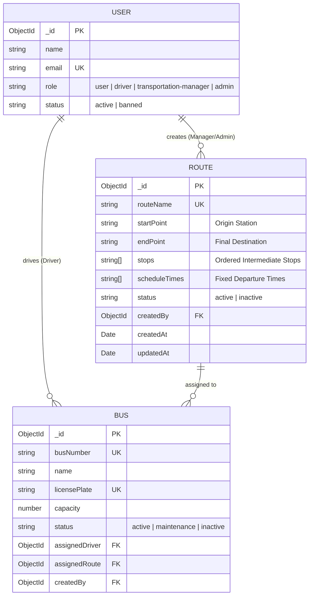
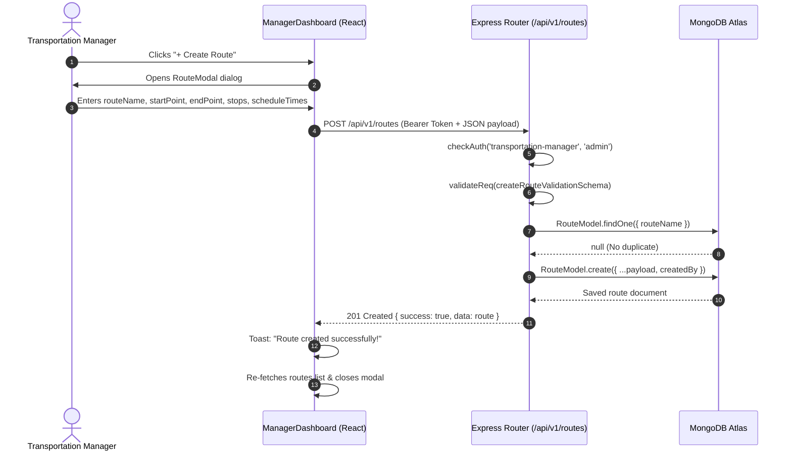
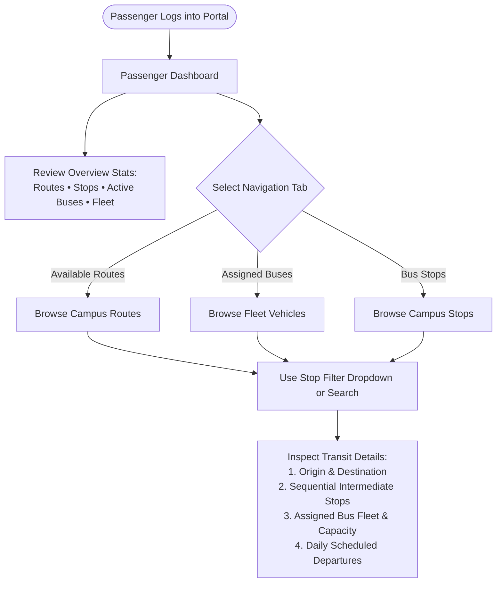

# 🚌 Campus Route Management & Passenger Transit Documentation

> **Versity Project Capstone — Functional & Technical Specification**  
> Covers the two core transit modules:
> 1. **Transportation Manager — Campus Route Management**: Create, view, update, delete, and associate stops with transit routes.
> 2. **Passenger Portal — Transit & Schedule Exploration**: View available routes, ordered bus stops, assigned fleet vehicles, and departure schedules.

---

## 📑 Table of Contents

1. [Executive Summary & Scope](#1-executive-summary--scope)
2. [System Architecture & Entity Relationships](#2-system-architecture--entity-relationships)
3. [Module 1: Campus Route Management (Transportation Manager)](#3-module-1-campus-route-management-transportation-manager)
   - [3.1 Functional Requirements](#31-functional-requirements)
   - [3.2 Route Database Schema](#32-route-database-schema)
   - [3.3 API Endpoint Reference](#33-api-endpoint-reference)
   - [3.4 Validation Rules & Zod Schemas](#34-validation-rules--zod-schemas)
   - [3.5 Service Layer & Business Logic](#35-service-layer--business-logic)
   - [3.6 Manager UI Components & Workflows](#36-manager-ui-components--workflows)
4. [Module 2: Passenger Transit & Schedule Exploration](#4-module-2-passenger-transit--schedule-exploration)
   - [4.1 Functional Requirements](#41-functional-requirements)
   - [4.2 Data Aggregation & Population Architecture](#42-data-aggregation--population-architecture)
   - [4.3 Passenger Views & Interactive Components](#43-passenger-views--interactive-components)
   - [4.4 Dynamic Filtering & Search Engine](#44-dynamic-filtering--search-engine)
5. [Role-Based Access Control (RBAC) Matrix](#5-role-based-access-control-rbac-matrix)
6. [Interactive Flow Diagrams](#6-interactive-flow-diagrams)
7. [Testing, Validation & Error Handling](#7-testing-validation--error-handling)

---

## 1. Executive Summary & Scope

Campus transit operations require synchronization between administrators and campus commuters. This documentation details two interconnected operational workflows:

```text
┌─────────────────────────────────────────────────────────────────────────────┐
│                       Campus Transit Operations                             │
└─────────────────────────────────────────────────────────────────────────────┘
          │                                                 │
          ▼                                                 ▼
┌───────────────────────────────────┐     ┌───────────────────────────────────┐
│     Transportation Manager        │     │        Passenger Commuter         │
├───────────────────────────────────┤     ├───────────────────────────────────┤
│ • Create origin-to-destination    │     │ • View available campus routes    │
│   pathways                        │     │ • Inspect ordered bus stops       │
│ • Configure intermediate stops    │     │ • View assigned shuttle buses     │
│ • Assign departure schedules      │     │ • View departure schedules        │
│ • Update / delete obsolete routes │     │ • Filter routes by specific stop  │
└───────────────────────────────────┘     └───────────────────────────────────┘
```

---

## 2. System Architecture & Entity Relationships

### Entity Relationship Model



---

## 3. Module 1: Campus Route Management (Transportation Manager)

### 3.1 Functional Requirements

Transportation Managers (and Administrators) have full authority to govern transit routes:
1. **Create Route**: Register a unique route with a route name, initial origin station, final destination station, optional intermediate stops, and daily departure times.
2. **Read / View Routes**: List all configured routes with creator details, active statuses, and real-time assigned buses.
3. **Update Route**: Modify route names, start/end terminals, status (`active` / `inactive`), intermediate stops, and schedule timings.
4. **Delete Route**: Remove routes with automatic referential integrity cleanup (buses assigned to deleted routes are automatically reset to `assignedRoute: null`).
5. **Intermediate Stop Association (`/api/v1/stop-associated`)**:
   - Add new intermediate bus stops with duplicate prevention.
   - Rename existing bus stops.
   - Reorder stop sequence (move earlier/later or batch update).
   - Delete specific stops.
   - Edit initial origin and last destination terminals.

---

### 3.2 Route Database Schema

Located in `Server/src/schema/route.schema.js`:

```javascript
import mongoose from 'mongoose';

const { Schema, model } = mongoose;

export const routeSchema = new Schema(
  {
    routeName: {
      type: String,
      required: [true, 'Route name is required'],
      unique: true,
      trim: true,
    },
    startPoint: {
      type: String,
      required: [true, 'Start point is required'],
      trim: true,
    },
    endPoint: {
      type: String,
      required: [true, 'End point is required'],
      trim: true,
    },
    stops: {
      type: [String],
      default: [],
    },
    scheduleTimes: {
      type: [String],
      default: [],
    },
    status: {
      type: String,
      enum: ['active', 'inactive'],
      default: 'active',
    },
    createdBy: {
      type: Schema.Types.ObjectId,
      ref: 'User',
      default: null,
    },
  },
  {
    timestamps: true,
    collection: 'route',
  }
);

export const RouteModel = mongoose.models.Route || model('Route', routeSchema);
export default RouteModel;
```

---

### 3.3 API Endpoint Reference

#### Base URL: `/api/v1/routes`

| Method | Endpoint | Authorized Roles | Description |
| :--- | :--- | :--- | :--- |
| `POST` | `/api/v1/routes` | `transportation-manager`, `admin` | Create a new campus route |
| `GET` | `/api/v1/routes` | `user`, `driver`, `transportation-manager`, `admin` | Get all routes (with assigned buses) |
| `GET` | `/api/v1/routes/:id` | `user`, `driver`, `transportation-manager`, `admin` | Get route details by ID |
| `PATCH` | `/api/v1/routes/:id` | `transportation-manager`, `admin` | Update route attributes |
| `DELETE` | `/api/v1/routes/:id` | `transportation-manager`, `admin` | Delete route & unbind assigned buses |

#### Stop Associated Sub-Module: `/api/v1/stop-associated`

| Method | Endpoint | Authorized Roles | Description |
| :--- | :--- | :--- | :--- |
| `GET` | `/api/v1/stop-associated` | All authenticated users | List all routes with stop journeys & assigned buses |
| `GET` | `/api/v1/stop-associated/:routeId` | All authenticated users | Detailed route stop sequence & assigned buses |
| `POST` | `/api/v1/stop-associated/:routeId/stops` | `transportation-manager`, `admin` | Add an intermediate stop to a route |
| `PATCH` | `/api/v1/stop-associated/:routeId/stops` | `transportation-manager`, `admin` | Rename an existing stop |
| `DELETE` | `/api/v1/stop-associated/:routeId/stops/:stopName` | `transportation-manager`, `admin` | Remove a stop by URL parameter |
| `DELETE` | `/api/v1/stop-associated/:routeId/stops` | `transportation-manager`, `admin` | Remove a stop by request body / query |
| `PUT` | `/api/v1/stop-associated/:routeId/stops` | `transportation-manager`, `admin` | Batch update / reorder full stops array |
| `PATCH` | `/api/v1/stop-associated/:routeId/endpoints` | `transportation-manager`, `admin` | Update initial start and final end stations |

---

### 3.4 Validation Rules & Zod Schemas

Located in `Server/src/app/module/Route/route.validation.js` & `Server/src/app/module/StopAssociated/stopAssociated.validation.js`:

```javascript
// Create Route Validation
const createRouteValidationSchema = z.object({
  body: z.object({
    routeName: z.string({ required_error: 'Route name is required' }).min(1),
    startPoint: z.string({ required_error: 'Start point is required' }).min(1),
    endPoint: z.string({ required_error: 'End point is required' }).min(1),
    stops: z.array(z.string()).optional(),
    scheduleTimes: z.array(z.string()).optional(),
    status: z.enum(['active', 'inactive']).optional(),
  }),
});

// Add Stop Validation
const addStopValidationSchema = z.object({
  body: z.object({
    stopName: z.string({ required_error: 'Stop name is required' }).min(1).trim(),
  }),
});

// Update Stop Name Validation
const updateStopValidationSchema = z.object({
  body: z.object({
    oldStopName: z.string({ required_error: 'Old stop name is required' }).trim(),
    newStopName: z.string({ required_error: 'New stop name is required' }).min(1).trim(),
  }),
});

// Batch Stops Reordering Validation
const updateAllStopsValidationSchema = z.object({
  body: z.object({
    stops: z.array(z.string().trim()).min(0),
  }),
});

// Update Endpoints Validation
const updateEndpointsValidationSchema = z.object({
  body: z.object({
    startPoint: z.string({ required_error: 'Start point is required' }).min(1).trim(),
    endPoint: z.string({ required_error: 'End point is required' }).min(1).trim(),
  }),
});
```

---

### 3.5 Service Layer & Business Logic

#### Route Creation & Referential Cleanup
* **Duplicate Prevention**: Before creating a route, `RouteModel.findOne({ routeName })` guarantees no duplicate route names.
* **Referential Cleanup on Delete**: When a route is deleted, `Bus.updateMany({ assignedRoute: id }, { assignedRoute: null })` unassigns all vehicles from the deleted route.

```javascript
const deleteRouteFromDB = async (id) => {
  const route = await RouteModel.findByIdAndDelete(id);
  if (!route) {
    throw new AppError(404, 'Route not found!');
  }
  // Safely unbind all buses
  await Bus.updateMany({ assignedRoute: id }, { assignedRoute: null });
  return route;
};
```

#### Intermediate Stops Management
* **Duplicate Stop Rejection**: `addStopToRouteInDB` enforces case-insensitive check `currentStops.some(s => s.toLowerCase() === cleanStop.toLowerCase())`.
* **Sequential Integrity**: `updateAllStopsInRouteInDB` trims whitespace and strips empty strings to maintain an ordered array.

---

### 3.6 Manager UI Components & Workflows

Located in `Clint/src/Pages/Manager/`:

| Component | File Path | Purpose |
| :--- | :--- | :--- |
| `ManagerDashboard.jsx` | `Clint/src/Pages/Manager/ManagerDashboard.jsx` | Parent manager shell with tab state management |
| `RouteModal.jsx` | `Clint/src/Pages/Manager/components/RouteModal.jsx` | Modal dialog for creating and editing routes |
| `ManagerDriverRouteAssignTab.jsx` | `Clint/src/Pages/Manager/components/ManagerDriverRouteAssignTab.jsx` | List routes, trigger edit/delete, bind buses to routes |
| `ManagerRouteStopAssociateTab.jsx` | `Clint/src/Pages/Manager/components/ManagerRouteStopAssociateTab.jsx` | Interactive route cards with visual stop ordering |
| `EditStopModal.jsx` | `Clint/src/Pages/Manager/components/EditStopModal.jsx` | Rename individual bus stop |
| `EditTerminalModal.jsx` | `Clint/src/Pages/Manager/components/EditTerminalModal.jsx` | Update initial origin and final destination terminals |

#### Manager Route Creation Flow



---

## 4. Module 2: Passenger Transit & Schedule Exploration

### 4.1 Functional Requirements

Commuter passengers (students, faculty, visitors) can browse and search transit information:
1. **Available Routes**: View all active campus routes, origin terminals, final destinations, and total intermediate stops.
2. **Bus Stops**: View all pickup and drop-off checkpoints in sequential journey order.
3. **Assigned Buses**: See which vehicles (bus number, model, plate, capacity, operational status, driver) are currently operating on each route.
4. **Departure Schedules**: Inspect daily timetable departures (e.g., `08:00 AM`, `08:30 AM`, `09:15 AM`) or continuous loop indicators.
5. **Stop-Centric Exploration**: Filter routes and buses by selecting any campus stop from a dropdown or search bar.

---

### 4.2 Data Aggregation & Population Architecture

To provide passengers with complete data in one query, the backend automatically joins and enriches route and bus data:

```javascript
// Server/src/app/module/Route/route.service.js
const getAllRoutesFromDB = async (query = {}) => {
  const routes = await RouteModel.find(filter)
    .populate('createdBy', 'name email role')
    .sort({ createdAt: -1 });

  // Efficient batch lookup of assigned buses for all routes
  const routeIds = routes.map((r) => r._id);
  const buses = await Bus.find({ assignedRoute: { $in: routeIds } })
    .populate('assignedDriver', 'name email image role')
    .select('busNumber name licensePlate capacity status assignedRoute assignedDriver');

  const busMap = {};
  buses.forEach((b) => {
    if (b.assignedRoute) {
      const rid = b.assignedRoute.toString();
      if (!busMap[rid]) busMap[rid] = [];
      busMap[rid].push(b);
    }
  });

  return routes.map((route) => ({
    ...route.toObject(),
    assignedBuses: busMap[route._id.toString()] || [],
  }));
};
```

---

### 4.3 Passenger Views & Interactive Components

Located in `Clint/src/Pages/Passenger/`:

```text
Clint/src/Pages/Passenger/
├── PassengerDashboard.jsx          # Main shell, stats grid, unified search & stop filter
└── components/
    ├── PassengerStats.jsx          # 4 Metric Cards (Routes, Stops, Active Buses, Vehicles)
    ├── PassengerRoutesTab.jsx      # Route cards with stop pathway, assigned buses, departures
    ├── PassengerBusesTab.jsx       # Vehicle cards with route binding, driver, capacities
    └── PassengerStopsTab.jsx       # Aggregated campus stop directory with serving routes
```

#### 1. Available Routes Tab (`PassengerRoutesTab.jsx`)
* **Terminal Pathway Banner**: Visual connection from Initial Origin ➔ Destination.
* **Ordered Stop Pathway**: Sequential badges (`#1`, `#2`, `#3`...) displaying the order of stops between terminals.
* **Assigned Buses Grid**: Live vehicle badges showing bus number, capacity, operational status (`active`, `maintenance`, `inactive`), and on-duty driver name.
* **Scheduled Departures**: Timetable pills with clock icons for all scheduled departure times.

#### 2. Assigned Buses Tab (`PassengerBusesTab.jsx`)
* Vehicle identification (bus number, model name, license plate).
* Seating capacity and operational status.
* Assigned transit route with origin, destination, intermediate stops, and scheduled departures.
* On-duty driver name with status badge.

#### 3. Campus Bus Stops Tab (`PassengerStopsTab.jsx`)
* Aggregates all unique campus checkpoints.
* For each stop, lists:
  * Routes serving the stop (with start/end terminals).
  * Departure times for each route.
  * Active buses servicing that stop.

---

### 4.4 Dynamic Filtering & Search Engine

Located in `Clint/src/Pages/Passenger/PassengerDashboard.jsx`:

1. **Case-Insensitive Stop Filter Helper**:
   ```javascript
   const cleanFilter = stopFilter ? stopFilter.toLowerCase().trim() : 'all';
   const isStopMatch = (target) => {
     if (cleanFilter === 'all') return true;
     if (!target) return false;
     return target.toLowerCase().trim() === cleanFilter;
   };
   ```

2. **Multi-Field Search**: Searches simultaneously across:
   - Route name
   - Start point & end point
   - Intermediate stop names
   - Scheduled departure times
   - Bus vehicle number, model, and license plate

3. **Live Metric Badges**:
   - `Available Routes` badge reflects matching route count.
   - `Assigned Buses` badge reflects matching bus count.
   - `Bus Stops` badge reflects matching stop count.

---

## 5. Role-Based Access Control (RBAC) Matrix

| Operation | User (Passenger) | Driver | Transportation Manager | System Admin |
| :--- | :---: | :---: | :---: | :---: |
| View Routes (`GET /api/v1/routes`) | ✅ | ✅ | ✅ | ✅ |
| View Single Route (`GET /api/v1/routes/:id`) | ✅ | ✅ | ✅ | ✅ |
| View Route Stops (`GET /api/v1/stop-associated`) | ✅ | ✅ | ✅ | ✅ |
| View Fleet Buses (`GET /api/v1/buses`) | ✅ | ✅ | ✅ | ✅ |
| Create Route (`POST /api/v1/routes`) | ❌ | ❌ | ✅ | ✅ |
| Update Route (`PATCH /api/v1/routes/:id`) | ❌ | ❌ | ✅ | ✅ |
| Delete Route (`DELETE /api/v1/routes/:id`) | ❌ | ❌ | ✅ | ✅ |
| Add / Rename / Reorder Stops | ❌ | ❌ | ✅ | ✅ |
| Assign Bus to Route (`PATCH /assign-route`) | ❌ | ❌ | ✅ | ✅ |

---

## 6. Interactive Flow Diagrams

### Passenger Transit Exploration Journey



---

## 7. Testing, Validation & Error Handling

### 7.1 Automated Backend Test Suite

Located in `Server/test-api.js`:

```javascript
// Test 24: Create Route (Transportation Manager)
const routeRes = await request('/api/v1/routes', {
  method: 'POST',
  headers: { Authorization: `Bearer ${managerToken}` },
  body: JSON.stringify({
    routeName: 'Campus Metro Loop',
    startPoint: 'North Gate',
    endPoint: 'Metro Station',
    stops: ['Central Library', 'Science Complex'],
    scheduleTimes: ['08:00 AM', '09:00 AM'],
  }),
});

// Test 31: Add Intermediate Stop
await request(`/api/v1/stop-associated/${routeId}/stops`, {
  method: 'POST',
  headers: { Authorization: `Bearer ${managerToken}` },
  body: JSON.stringify({ stopName: 'Dormitory Quad' }),
});

// Test 34: Reorder Stops
await request(`/api/v1/stop-associated/${routeId}/stops`, {
  method: 'PUT',
  headers: { Authorization: `Bearer ${managerToken}` },
  body: JSON.stringify({ stops: ['Central Library', 'Dormitory Quad', 'Science Complex'] }),
});

// Test 30: Security Guard - Passenger Blocked (Expected 403)
const blockedRes = await request('/api/v1/routes', {
  method: 'POST',
  headers: { Authorization: `Bearer ${passengerToken}` },
  body: JSON.stringify({ routeName: 'Unauthorized Route' }),
});
assert(blockedRes.status === 403);
```

### 7.2 Error Handling & Edge Cases

| Scenario | Handled Condition | Resulting Response |
| :--- | :--- | :--- |
| Duplicate Route Name | `RouteModel.findOne({ routeName })` | `400 Bad Request: "Route with this name already exists!"` |
| Duplicate Stop on Route | `stops.some(s => s.toLowerCase() === name.toLowerCase())` | `400 Bad Request: "Stop ... is already associated with this route"` |
| Non-Existent Route | `RouteModel.findById(id)` returns `null` | `404 Not Found: "Route not found!"` |
| Unauthorized Route Modification | Role is not `transportation-manager` or `admin` | `403 Forbidden: "You are not authorized to perform this action"` |
| Deleted Route Cleanup | `Bus.updateMany({ assignedRoute: id })` | Assigned buses automatically reset to unassigned |
| Case-Insensitive Filter | `.toLowerCase().trim()` | Matches `"Panchabati"` with `"panchabati"` |

---

### 7.3 Build Verification

Both client and server have been verified:
* **Server**: Syntax verified with `node --check` across all route, bus, and stop modules.
* **Client**: Bundled and compiled with `npm run build --prefix Clint` with zero linting or JSX errors.
